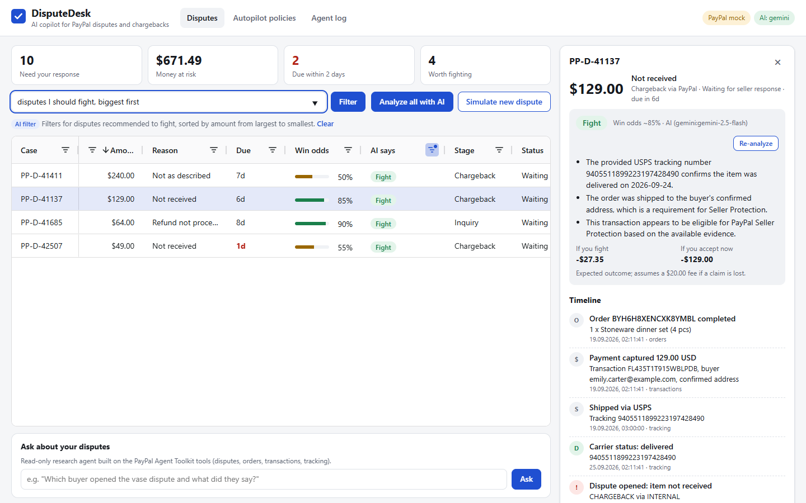

# DisputeDesk

**An AI copilot for PayPal sellers that triages disputes and chargebacks, drafts the evidence, and tells you whether a case is worth fighting.**

Built for the [PayPal AI Hackathon](https://paypalaihackathon.devpost.com/) (Devpost, Oct-Nov 2026).



## The problem

A small online seller gets a PayPal dispute: "item not received", "not as described", a card chargeback. A response deadline starts running (often 10 days or less), and the seller has to:

1. dig through PayPal for the payment, the order, the tracking number and the buyer's messages;
2. guess whether the case is winnable or whether a quick refund is cheaper;
3. write evidence that a PayPal reviewer will accept, in the right evidence type, with the right tracking or refund ids.

Most small sellers either refund everything (losing money and inventory) or fight everything (losing time, and fees on lost claims). Deadlines get missed. Nobody has a log of what was decided and why.

## What DisputeDesk does

- **One table of every dispute** (AG Grid): amount, reason, deadline, estimated win odds, and a recommendation: *Fight*, *Accept*, *Message buyer* or *Wait*.
- **Plain-English filters**: type "not received over $100 due this week" or "chargebacks worth fighting, biggest first"; an LLM turns it into a validated AG Grid filter model (with an offline keyword parser as fallback).
- **Case card with a full timeline** assembled from five PayPal APIs: order, payment capture, refunds, shipment and delivery, dispute messages, deadline.
- **Evidence drafts ready to send**: structured parts (tracking numbers, refund ids) are always taken from PayPal data; the LLM only writes the explanatory prose, and any text that mentions an id PayPal did not return is discarded.
- **One-click actions** with confirmation: *Send evidence* (`provide-evidence`), *Accept claim* (`accept-claim`, with the allowed accept types), *Send message* (`send-message`), editable before sending.
- **Autopilot policies**: e.g. "refund not-as-described claims under $15", "send tracking on item-not-received inquiries". Policies fire only when the AI's own recommendation agrees, respect a daily refund cap and a global kill switch, and support dry-run.
- **Webhook-driven**: `CUSTOMER.DISPUTE.CREATED` arrives, the signature is verified, the case is analyzed and policies run, all in the background.
- **Agent log**: every webhook, analysis, policy decision and seller action is journaled (`data/audit.jsonl`) and shown in its own grid.
- **Ask DisputeDesk**: a read-only research agent built on the official **PayPal Agent Toolkit** tools (`list_disputes`, `get_dispute`, `list_transactions`, `get_order`, `get_shipment_tracking`). Ask "what exactly did the vase buyer write, and was it delivered?"

## How it works

```
                PayPal (sandbox)                                         DisputeDesk server (Node 22, TypeScript)
 ┌─────────────────────────────────────────┐   OAuth 2.0 client creds   ┌──────────────────────────────────────────────────┐
 │ Disputes v1   list/get/provide-evidence │◄───────────────────────────┤ PayPalGateway  (HttpPayPalClient | MockPayPal)   │
 │               accept-claim/send-message │                            │        │                                         │
 │ Orders v2     get order                 │                            │        ▼                                         │
 │ Transaction Search v1                   │                            │ Case file builder ── timeline + facts + gaps     │
 │ Shipment Tracking v1                    │                            │        │                                         │
 │ Webhooks v1   verify-webhook-signature  │                            │        ▼                                         │
 └──────────────┬──────────────────────────┘                            │ Rules baseline ──► LLM refinement (guarded)      │
                │ CUSTOMER.DISPUTE.CREATED                              │   Gemini / Groq, OpenAI-compatible, JSON only    │
                └──────────────────────────────────────────────────────►│        │                                         │
                                                                        │        ▼                                         │
                                                                        │ Policy engine ── audit journal                   │
                                                                        │ NL query → AG Grid filter model                  │
                                                                        │ Ask agent → @paypal/agent-toolkit tools          │
                                                                        └───────────────┬──────────────────────────────────┘
                                                                                        │ /api
                                                                        ┌───────────────▼──────────────────────────────────┐
                                                                        │ React + AG Grid Community: disputes grid,        │
                                                                        │ case card, policies, agent log, ask box          │
                                                                        └──────────────────────────────────────────────────┘
```

**Analysis pipeline per dispute**

1. **Collect.** `GET /v1/customer/disputes/{id}` gives the claim, messages and deadline. The seller transaction id drives `GET /v1/reporting/transactions` (walked in 30-day windows, because the API allows at most 31 days per call, so later refunds are found) and `GET /v1/shipping/trackers?transaction_id=`. The order is loaded with `GET /v2/checkout/orders/{id}` when the merchant passed the order id as `custom_id` at checkout. Each source is optional; a failure becomes a visible "data gap", never a crash.
2. **Rules baseline.** Deterministic priors per reason code (delivered with tracking to a confirmed address, refund already issued, digital goods, Seller Protection eligibility, and so on), an expected-value comparison of fighting against refunding now, and evidence entries built only from PayPal data. This is the answer when no LLM key is set or the LLM fails.
3. **LLM refinement.** The case file and baseline go to Gemini (fallback: Groq) with a strict JSON contract. Output is validated: unknown recommendations are rejected, win odds may move at most ±25 points from the baseline, a case PayPal is reviewing stays *Wait*, and prose containing an id-like token PayPal never returned is dropped.
4. **Act.** The seller confirms, or a policy acts. Everything is journaled.

## Run it

Requirements: Node.js 22.19+ (runs TypeScript directly, no build step for the server).

```bash
git clone https://github.com/ttimesai-star/disputedesk
cd disputedesk
npm install
npm run build        # builds the React app
npm start            # http://127.0.0.1:8787
```

With no configuration it starts in **mock mode**: an in-memory PayPal with a demo shop and 12 disputes covering every common reason. Mock responses follow the official PayPal OpenAPI schemas and enforce the same state rules (for example, no evidence once a case is under review). Click **Simulate new dispute** to fire a signed `CUSTOMER.DISPUTE.CREATED` webhook at the server.

Optional `.env` (see `.env.example`):

| Variable | Effect |
| --- | --- |
| `PAYPAL_CLIENT_ID`, `PAYPAL_CLIENT_SECRET` | Use the PayPal **sandbox** (`api-m.sandbox.paypal.com`). Live mode is refused by design. |
| `PAYPAL_WEBHOOK_ID` | Webhook id used to verify incoming signatures (`PAYPAL_WEBHOOK_VERIFY=offline` switches from the verify API to local CRC32 + certificate verification). |
| `GEMINI_API_KEY` / `GROQ_API_KEY` | Enable AI analysis, plain-English filters and the Ask agent. Both have free tiers. Without them, everything runs on rules. |

Other commands:

```bash
npm test                         # unit + API tests (node:test), no network needed
npm run typecheck
npm run analyze -- PP-D-41137    # CLI: analyze one dispute (or all open ones without an id)
npm run dev:server & npm run dev:web   # hot reload during development
```

**Sandbox setup.**

1. In the [PayPal Developer Dashboard](https://developer.paypal.com/dashboard/applications/sandbox) (Sandbox mode) click **Create App**, type *Merchant*, linked to your default sandbox business account.
2. In the app's **Features** enable **Customer disputes** (Disputes API) and **Transaction search** (Reporting API, used to find refunds), then **Save Changes**. A scope added later shows up only in a newly issued token; PayPal reuses a cached token for up to 9 hours.
3. Copy the client id and secret into `.env` (never commit it; `.env` is git-ignored):
   ```bash
   cp .env.example .env
   # PAYPAL_CLIENT_ID=...  PAYPAL_CLIENT_SECRET=...  PAYPAL_ENV=sandbox
   ```
4. Check the keys:
   ```bash
   curl -s -u "$PAYPAL_CLIENT_ID:$PAYPAL_CLIENT_SECRET" -d grant_type=client_credentials \
     https://api-m.sandbox.paypal.com/v1/oauth2/token
   ```
5. Add a webhook to `https://<your-host>/api/webhooks/paypal` subscribed to `CUSTOMER.DISPUTE.CREATED`, `CUSTOMER.DISPUTE.UPDATED` and `CUSTOMER.DISPUTE.RESOLVED`, and put its id in `PAYPAL_WEBHOOK_ID`. The dashboard's Webhooks Simulator can then send test events.
6. To get real sandbox disputes: log in at `https://www.sandbox.paypal.com` as the sandbox *personal* (buyer) account, pay the business account (for example through an order created with `POST /v2/checkout/orders`), then open a dispute from the buyer's Resolution Center. It appears in `GET /v1/customer/disputes` for the business account.

With both variables set the server switches from the mock to the sandbox automatically; remove them to go back to mock mode.

**Security notes.** The server binds to `127.0.0.1` by default because the dashboard can issue refunds and has no login; set `HOST=0.0.0.0` only inside a private network. Secrets are read from the environment only and never logged. Webhooks with missing or invalid signatures are rejected with 401.

## Project layout

```
server/src/paypal/   PayPal gateway interface, REST client, mock + demo data, webhook verification
server/src/agent/    case file, rules, LLM pipeline, policies, audit log, NL query, Ask agent
server/src/app.ts    HTTP API + static hosting
server/test/         tests for the PayPal client, webhook verification, pipeline, policies, query, API
web/src/             React + AG Grid UI
docs/                notes on API field checks and the AG Grid trial request
```

## Notes on the PayPal Agent Toolkit

`@paypal/agent-toolkit` 1.11.0 covers `list_disputes`, `get_dispute` and `accept_dispute_claim`, but not `provide-evidence` or `send-message`. DisputeDesk uses the toolkit for the read-only Ask agent and calls the REST API directly for writes, so every write goes through confirmation or a policy and lands in the journal. Two things we found while integrating it (details in [docs/paypal-api-notes.md](docs/paypal-api-notes.md)):

- The toolkit defaults to the **live** API unless `configuration.context.sandbox` is `true`; DisputeDesk always sets it.
- In 1.11.0 the `note` argument of `accept_dispute_claim` is validated with the dispute-id regex, so a normal sentence is rejected. Another reason accept-claim goes through our own client.

## Built with AI coding agents

In line with the hackathon's request to list AI tools: this project was written with AI coding agents. Anthropic's Claude (via Claude Code) wrote most of the code under the author's direction and review, and Google's Jules was used as an independent code reviewer. At runtime the product uses Google Gemini (and optionally Groq-hosted Llama) for dispute analysis, filter translation and the Ask agent, plus the PayPal Agent Toolkit tool definitions. Every API field was checked against PayPal's published OpenAPI specifications.

## Disclaimer

Win odds are heuristic estimates refined by an LLM, not legal or financial advice. DisputeDesk talks only to the PayPal sandbox.

## License

[MIT](LICENSE)
